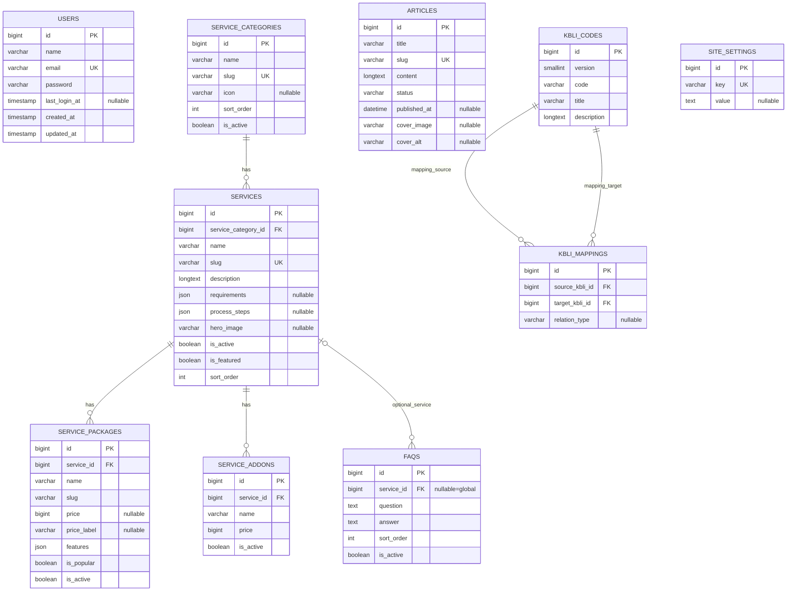

# LegalPartner.ID — Product Requirements Document, ERD, Design System & Implementation Roadmap

> **Produk:** LegalPartner.ID  
> **Brand byline:** by Simetric Consulting Group  
> **Versi:** 1.0 — Baseline spesifikasi  
> **Tanggal:** 19 Oktober 2026  
> **Primary:** `#1345AD` · **Font:** Google Fonts **Poppins** · **Theme:** **Light mode only**  
> **Stack:** Laravel 13 · React 19 · Inertia.js 3 · TypeScript · Tailwind CSS 4 · shadcn/ui (Radix) · MySQL 8+  
> **Status:** Dokumen rancangan, **bukan** aplikasi yang telah selesai dibangun.

---

## 0. Panduan status & cara memakai dokumen

- `[x]` = keputusan/kriteria **sudah ditetapkan pada dokumen ini**; bukan berarti kodenya telah dibuat.
- `[ ]` = **belum diimplementasikan atau belum diverifikasi** pada repository.
- Setiap task implementasi baru boleh diubah menjadi `[x]` setelah *code merged + diuji + memenuhi acceptance criteria*.
- Boleh mencatat ID pull request, commit, bukti screenshot, atau hasil test di samping task.
- Prioritas: **P0** wajib MVP; **P1** sesudah MVP; **P2** opsional. Estimasi merupakan perencanaan, bukan janji timeline.

### Status keputusan produk (selesai sebagai spesifikasi)

- [x] Nama aplikasi **LegalPartner.ID** dan byline **by Simetric Consulting Group**.
- [x] Primary color `#1345AD`, hanya **light mode**.
- [x] Google Font **Poppins** dan komponen UI berbasis **shadcn/ui**.
- [x] Pengunjung tanpa akun; **admin saja** yang bisa login.
- [x] Tidak ada registrasi customer, cart, checkout, payment gateway, tracking pesanan.
- [x] Semua tombol konsultasi/pilih paket mengarah ke **WhatsApp**.
- [x] 48 target layanan + detail dinamis; pricing, blog SEO, mega menu.
- [x] Lima tools: biaya layanan, PPh, PPN, screening nama PT, pencarian KBLI 2025.
- [x] **Breadcrumb + page title + description** pada **setiap halaman**, termasuk halaman login, tools, error, dan admin.
- [x] Standar field **label, placeholder, tanda `*` untuk required, help text, validasi dan feedback**.
- [x] Sonner: sukses hijau, peringatan oranye, error merah.
- [x] Preview gambar yang terasa seperti CMS modern, bukan ilustrasi berlebihan/AI slop.
- [x] Prinsip performa, SSR, indexing, eager loading, dan pengujian terdokumentasi.

### Status implementasi (awal)

- [ ] Repository/project yang akan digunakan telah diaudit dan dijalankan.
- [ ] Migrations, routes, React pages, UI components, tests, dan deployment dikerjakan.
- [ ] Seluruh acceptance criteria diuji di browser dan perangkat nyata.

**Aturan anti-klaim:** mockup sebelumnya hanyalah referensi visual. Angka seperti total pengunjung, konversi, persentase pertumbuhan, dan testimoni **tidak boleh ditampilkan sebagai data asli** sebelum ada sumber data yang nyata.

---

# 1. PRD — Product Requirements Document

## 1.1 Ringkasan produk

LegalPartner.ID adalah website jasa legalitas dan konsultasi perizinan bisnis. Tujuan situs: membantu pengunjung menemukan layanan, memahami persyaratan, membandingkan paket, menggunakan tools edukasi, membaca artikel, lalu **menghubungi admin melalui WhatsApp**. Backoffice admin digunakan untuk mengelola katalog, harga, FAQ, artikel, KBLI, dan pengaturan situs.

### Problem yang diselesaikan

1. Informasi jasa legalitas tersebar dan sulit dibandingkan.
2. Calon klien ingin tahu jenis layanan, perkiraan harga, syarat, dan proses sebelum menghubungi konsultan.
3. Tim internal membutuhkan CMS agar harga dan konten bisa diperbarui tanpa edit kode.
4. Tools edukasi seperti cek KBLI dan simulasi biaya membantu *lead qualification*, tanpa klaim sebagai validasi pemerintah.

### Tujuan produk

- **Bisnis:** meningkatkan kontak WhatsApp yang berkualitas dari halaman layanan, pricing, dan artikel.
- **Pengunjung:** menemukan solusi dan CTA konsultasi tanpa login.
- **Admin:** mengubah konten dan harga dengan cepat, aman, dan dapat dipratinjau.
- **Teknis:** tetap cepat, ramah SEO, aman, modular, dan mudah dirawat.

### Di luar scope MVP

- Akun/registrasi pelanggan; multi-role/RBAC, Spatie Permission.
- Keranjang, checkout, payment gateway, invoice transaksi, order/tracking.
- Pengajuan otomatis ke AHU, OSS, DJKI, BPOM, atau sistem pemerintah lain.
- Integrasi WhatsApp Business API/chatbot/two-way sync.
- AI untuk merek, kurs real-time, GIS interaktif/zoning real-time.
- Dashboard dengan angka traffic/lead yang direkayasa.

## 1.2 Persona dan hak akses

| Persona | Kebutuhan | Hak akses |
|---|---|---|
| Pengunjung/pemilik usaha | Cari jasa, bandingkan paket, baca syarat, pakai tools, klik WA | Publik, tanpa login |
| Admin konten (satu tipe akun) | CRUD layanan, harga, FAQ, artikel, KBLI, setting | Login admin, semua fitur backoffice |

**RBAC:** Tidak perlu tabel `roles`/`permissions`. Semua akun di `users` dibuat oleh operator tepercaya sebagai admin; registrasi publik harus dimatikan. Bila nanti muncul staff dengan hak akses berbeda, desain otorisasi dievaluasi ulang.

## 1.3 User goals / jobs to be done

**Pengunjung**

- G-01: Dalam <=3 klik dari homepage, menemukan kategori atau layanan yang diinginkan.
- G-02: Melihat harga, cakupan paket, durasi, persyaratan dan proses secara jelas.
- G-03: Menghubungi WhatsApp dengan pesan yang memuat layanan dan paket yang dipilih.
- G-04: Menggunakan simulasi biaya/pajak tanpa memasukkan data identitas.
- G-05: Mencari kode KBLI dan membaca uraian klasifikasi beserta versi sumber.
- G-06: Memahami bahwa cek nama PT hanyalah *screening awal*, bukan validasi AHU.

**Admin**

- G-07: Menambah/mengubah layanan, kategori, paket, FAQ dari satu panel.
- G-08: Mengunggah cover dengan *preview* sebelum menyimpan.
- G-09: Memublikasikan/mengedit artikel SEO dengan tampilan pratinjau.
- G-10: Mengimpor/memperbarui data KBLI tanpa membuat duplikasi.
- G-11: Mengubah nomor WA dan informasi perusahaan tanpa deploy kode.
- G-12: Memahami status setiap aksi melalui toast/notifikasi yang tepat.

**Sistem**

- G-13: Google dapat mengindeks halaman publik penting (SSR, sitemap, metadata).
- G-14: Menghindari query N+1 dan overfetching; mampu menangani pencarian KBLI.
- G-15: Hanya admin terautentikasi yang dapat memutasi data dan file.

## 1.4 Success metrics & guardrails

| Indikator | Cara ukur | Catatan |
|---|---|---|
| CTA WA clicks | Event analytics non-PII `wa_cta_click` | Klik **bukan** chat terkirim/lead pasti |
| Service page views | Analytics hanya jika diaktifkan | Minta persetujuan bila diperlukan |
| Catalog findability | Uji tugas pengguna | Target: layanan ditemukan <=3 klik |
| Content correctness | Review konten + audit tanggal | Harga/klaim hukum harus akurat |
| UX performance | Lighthouse + field Core Web Vitals | LCP <=2,5s; INP <=200ms; CLS <=0,1 pada p75 sebagai target |
| Accessibility | Automated checks + keyboard/screen reader sampling | Target WCAG 2.2 AA untuk alur penting |
| Database queries | Query logs/profiler di staging | N+1 = 0 pada halaman utama |

Metrics dashboard admin **MVP** menggunakan hitungan nyata dari database (`services`, `packages`, `articles`, `kbli_codes`) + aktivitas yang benar-benar dicatat, **bukan** grafik pengunjung palsu. Analytics pemasaran masuk P1 hanya bila dipasang secara benar.

## 1.5 Functional requirements (FR)

| ID | Requirement | Prioritas | Acceptance criteria singkat |
|---|---|---|---|
| FR-001 | Publik dapat membuka semua halaman tanpa login | P0 | Tidak diarahkan ke form login |
| FR-002 | Katalog 48 target layanan | P0 | Seed aktual, slug unik, hanya active published |
| FR-003 | Mega menu desktop & drawer mobile | P0 | Navigasi keyboard/touch, kategori & tools terbaca |
| FR-004 | Detail layanan dinamis | P0 | Hero, paket, persyaratan, proses, FAQ, related, SEO |
| FR-005 | Halaman harga | P0 | Filter kategori, paket sesuai data, CTA |
| FR-006 | Klik WA | P0 | Link wa.me encoded, nomor dari setting, pesan kontekstual |
| FR-007 | Blog publik | P0 | Listing, detail, status publish, slug, SEO |
| FR-008 | Kalkulator biaya | P0 | Estimasi deterministik, rinci, disclaimer, CTA |
| FR-009 | Kalkulator PPh | P0 | Skenario terbatas dan tervalidasi per periode aturan |
| FR-010 | Kalkulator PPN | P0 | Jenis transaksi/perlakuan sesuai aturan yang berlaku |
| FR-011 | Screening nama PT | P0 | Aturan lokal, hasil tidak mengklaim data AHU |
| FR-012 | Search KBLI 2025 | P0 | Dataset resmi, pencarian, paging, versi, mapping jika ada |
| FR-013 | Login admin | P0 | Tanpa register, rate limit, session secure, logout |
| FR-014 | CMS layanan dan harga | P0 | CRUD+status+preview+validasi+toast |
| FR-015 | CMS artikel/FAQ | P0 | CRUD, draft/publish, SEO, preview |
| FR-016 | KBLI import/admin | P0 | Dry-run validasi, report, idempotent import |
| FR-017 | Site settings | P0 | WA, email, alamat, identitas sosial dan metadata |
| FR-018 | Breadcrumb/title/desc semua page | P0 | Komponen PageHeader di semua route termasuk error/login |
| FR-019 | Form standard | P0 | Placeholder, required *, errors, loading/disabled, a11y |
| FR-020 | Sonner colors | P0 | Sukses hijau, warning oranye, error merah |
| FR-021 | Light mode only | P0 | Tak ada toggle, `.dark` rules, persisten tema atau theme provider |
| FR-022 | Upload gambar + preview modern | P0 | Validasi ukuran/jenis, preview, remove/replace, alt |
| FR-023 | SSR, sitemap, robots, canonical | P0 | Metadata dapat dibaca crawler dari HTML awal |
| FR-024 | Quick search admin | P1 | Cari layanan dan artikel, tautan hasil |
| FR-025 | Audit perubahan & analitik WA | P1 | Hanya event/riwayat yang benar-benar tersedia |
| FR-026 | CSV export katalog | P2 | Export terbatas hanya admin |

## 1.6 Non-functional requirements (NFR)

- **NFR-01 Performa:** SSR halaman publik, Vite splitting, image sizes & lazy loading, caching read-heavy, optimasi query.
- **NFR-02 Keamanan:** auth admin, CSRF, rate limit login, validation server-side, password hashing, escaping user text, sanitize Markdown/HTML, file validation.
- **NFR-03 SEO:** semantic HTML, satu H1 per page, canonical, og/meta, breadcrumb JSON-LD bila relevan, sitemap.
- **NFR-04 Aksesibilitas:** keyboard navigation, focus ring, label/input associations, error live region, contrast, reduced motion.
- **NFR-05 Maintainability:** reusable shadcn/ui primitives, typed props, service classes seperlunya, no duplicated pricing/tax logic.
- **NFR-06 Legal disclaimer:** hasil kalkulasi dan screening edukatif, bukan jaminan administrasi atau keputusan pemerintah.
- **NFR-07 Data privacy:** jangan merekam input nama PT, gaji, atau hasil hitungan tanpa kebutuhan, izin, dan kebijakan yang jelas.
- **NFR-08 Browser:** Chrome/Safari/Firefox/Edge modern dan responsive 320px ke atas.

---

# 2. Sitemap, page inventory, dan standar wajib semua halaman

## 2.1 PageShell wajib

**SELURUH halaman** memiliki tiga elemen yang konsisten:

1. **Breadcrumb** (`Breadcrumb`, `BreadcrumbList`, `BreadcrumbItem`, `BreadcrumbLink`, `BreadcrumbPage`) — tautan hierarkis; item terakhir bukan link.
2. **Title/H1** jelas dan unik — di dalam `PageHeader`.
3. **Description** tepat di bawah judul (1–2 kalimat), juga ditentukan melalui SEO description bila halaman publik.

**Homepage:** breadcrumb kecil `Beranda`, title hero sekaligus H1, description berupa subheading hero. **Login:** breadcrumb `Beranda / Login Admin` di bagian atas kartu atau halaman, title `Masuk Admin`, description kecil. **Error/404:** breadcrumb `Beranda / Halaman Tidak Ditemukan`, title dan deskripsi solusi. **Admin dashboard:** breadcrumb `Admin / Dashboard` (Admin mengarah ke dashboard), H1 `Ringkasan Dashboard`, description instruktif.

> `PageHeader` bukan library UI terpisah: ia merupakan komposisi primitives **shadcn/ui Breadcrumb, Separator, Button** dan elemen HTML semantik (`h1`, `p`, `nav`).

## 2.2 Semua halaman publik (wajib)

| Route | Breadcrumb | H1/Title | Description wajib | Komponen utama |
|---|---|---|---|---|
| `/` | Beranda | Solusi Legalitas Bisnis untuk Usaha Anda | Temukan layanan dan konsultasi via WhatsApp | Hero, Card, Button, Accordion |
| `/layanan` | Beranda / Layanan | Semua Layanan | Jelajahi layanan per kategori dan cari kebutuhan usaha | Input, Tabs/Select, Card, Pagination |
| `/layanan/{slug}` | Beranda / Layanan / {nama} | {Nama Layanan} | Ringkasan spesifik layanan | Breadcrumb, Tabs, Card, Accordion, Button |
| `/harga` | Beranda / Harga | Daftar Harga Layanan | Bandingkan pilihan paket sesuai kebutuhan | Tabs, Card, Badge, Button |
| `/blog` | Beranda / Blog | Artikel & Insight | Panduan legalitas dan perizinan usaha | Card, Input, Pagination |
| `/blog/{slug}` | Beranda / Blog / {judul} | {Judul Artikel} | Ringkasan artikel | Breadcrumb, Separator, Card, ShareButton |
| `/tools` | Beranda / Tools | Tools Gratis | Alat bantu untuk estimasi dan referensi awal | Card, Badge, Button |
| `/tools/kalkulator-biaya` | Beranda / Tools / Kalkulator Biaya | Kalkulator Biaya Layanan | Estimasi awal paket dan layanan | Field, Select, Card, Alert |
| `/tools/kalkulator-pph` | Beranda / Tools / PPh | Kalkulator PPh | Simulasi sesuai skenario dan periode aturan | Field, Input, Select, Alert |
| `/tools/kalkulator-ppn` | Beranda / Tools / PPN | Kalkulator PPN | Hitung estimasi PPN berdasarkan perlakuan pajak | Field, Input, Select, Alert |
| `/tools/cek-nama-pt` | Beranda / Tools / Cek Nama PT | Cek Format Nama PT | Pemeriksaan aturan nama awal, bukan validasi AHU | Field, Input, Alert, Card |
| `/tools/cek-kbli` | Beranda / Tools / Cek KBLI | Pencarian KBLI 2025 | Temukan kode dan uraian dari klasifikasi BPS | Input, Table/Card, Pagination |
| `/tentang-kami` | Beranda / Tentang Kami | Tentang LegalPartner.ID | Profil, pendekatan, dan informasi perusahaan | Card, Separator, CTA |
| `/kontak` | Beranda / Kontak | Hubungi Kami | Hubungi tim melalui WhatsApp dan kanal resmi | Card, Button, Separator |
| `/faq` | Beranda / FAQ | Pertanyaan yang Sering Diajukan | Jawaban umum terkait layanan dan proses | Accordion, Input |
| `/kebijakan-privasi` | Beranda / Kebijakan Privasi | Kebijakan Privasi | Penjelasan data yang diproses website | Card, Separator |
| `/syarat-ketentuan` | Beranda / Syarat dan Ketentuan | Syarat dan Ketentuan | Ketentuan informasi, estimasi, dan konsultasi | Card, Separator |
| fallback `404` | Beranda / 404 | Halaman Tidak Ditemukan | Halaman tidak tersedia; arahkan kembali | Button, Card, icon |
| fallback `500` | Beranda / Gangguan | Terjadi Gangguan | Coba lagi atau hubungi admin | Alert, Button |

**Aturan halaman publik:** semua CTA WA merupakan tautan eksternal aman dengan `target="_blank"`/`rel="noopener noreferrer"` bila membuka tab baru. Jumlah layanan 48 adalah target data, bukan 48 komponen React berbeda.

## 2.3 Semua halaman admin (wajib)

| Route | Breadcrumb | H1 | Description wajib | Komponen utama |
|---|---|---|---|---|
| `/admin/login` | Beranda / Login Admin | Masuk Admin | Akses pengelolaan LegalPartner.ID | Card, Field, Input, Checkbox, Button |
| `/admin/dashboard` | Admin / Dashboard | Ringkasan Dashboard | Kelola konten dan data LegalPartner.ID | Card, Chart, Table, Button |
| `/admin/kategori` | Admin / Kategori Layanan | Kategori Layanan | Atur kelompok dan urutan layanan | Data Table, Dialog, Input |
| `/admin/kategori/tambah` | Admin / Kategori / Tambah | Tambah Kategori | Buat kategori layanan baru | Field, Input, Textarea |
| `/admin/kategori/{id}/edit` | Admin / Kategori / Edit | Edit Kategori | Perbarui nama, icon, dan status | Field, Input, Select |
| `/admin/layanan` | Admin / Layanan | Manajemen Layanan | Kelola detail layanan dan status tayang | Data Table, Input, DropdownMenu |
| `/admin/layanan/tambah` | Admin / Layanan / Tambah | Tambah Layanan | Lengkapi informasi layanan dan SEO | Form sections, ImagePreview |
| `/admin/layanan/{id}/edit` | Admin / Layanan / Edit | Edit Layanan | Perbarui informasi layanan yang dipilih | Tabs, Form, ImagePreview |
| `/admin/paket` | Admin / Paket Harga | Paket Harga | Kelola harga dan fasilitas paket | Data Table, Badge |
| `/admin/paket/tambah` | Admin / Paket / Tambah | Tambah Paket | Buat pilihan harga untuk sebuah layanan | Field, Select, Input, dynamic list |
| `/admin/paket/{id}/edit` | Admin / Paket / Edit | Edit Paket | Ubah harga, manfaat, dan visibilitas | Form, AlertDialog |
| `/admin/faq` | Admin / FAQ | Manajemen FAQ | Kelola FAQ umum dan FAQ tiap layanan | Data Table, Dialog |
| `/admin/faq/tambah` | Admin / FAQ / Tambah | Tambah FAQ | Tulis pertanyaan dan jawaban | Form, Textarea |
| `/admin/faq/{id}/edit` | Admin / FAQ / Edit | Edit FAQ | Perbarui jawaban dan urutan | Form, Switch |
| `/admin/artikel` | Admin / Artikel | Manajemen Artikel | Kelola konten blog dan status publikasi | Data Table, Tabs |
| `/admin/artikel/tambah` | Admin / Artikel / Tambah | Tulis Artikel | Buat artikel baru yang siap SEO | Form, Markdown Preview, ImagePreview |
| `/admin/artikel/{id}/edit` | Admin / Artikel / Edit | Edit Artikel | Perbarui konten, metadata, dan status | Tabs, Form, Preview |
| `/admin/kbli` | Admin / KBLI | Data KBLI | Cari, lihat, dan kelola dataset KBLI | Data Table, Search, Badge |
| `/admin/kbli/import` | Admin / KBLI / Import | Import Data KBLI | Validasi dan impor dataset resmi | File Input, Alert, Progress |
| `/admin/kbli/mapping` | Admin / KBLI / Mapping | Mapping KBLI | Periksa hubungan versi KBLI | Table, Filters, Detail Dialog |
| `/admin/pengaturan` | Admin / Pengaturan | Pengaturan Website | Atur identitas, kontak, SEO global | Tabs, Form, ImagePreview |
| `/admin/profil` | Admin / Profil | Profil Admin | Kelola nama dan keamanan akun admin | Field, Input, Password |
| admin `403/404/500` | Admin / {status} | Tidak Dapat Mengakses Halaman | Penjelasan masalah dan tindakan berikutnya | Alert, Button |

**UX:** untuk penghapusan konten gunakan `AlertDialog`; untuk membuat/mengedit data panjang gunakan halaman khusus (bukan dialog kecil). Admin sidebar berisi Dashboard, Kategori, Layanan, Paket Harga, FAQ, Artikel, KBLI, Mapping, Pengaturan, Profil, dan *Lihat Website*.

## 2.4 Template visual per halaman

### Website publik

```text
[SiteHeader: logo | layanan mega menu | tools mega menu | blog | CTA WA]
[Breadcrumb: Beranda / ...]
[H1 Title]
[Description ringkas]
[Main: konten spesifik, grid/card/forms sesuai halaman]
[Section CTA WA jika relevan]
[SiteFooter]
[Floating WhatsApp CTA]
```

### Admin (light, compact, premium — bukan UI generik berlebihan)

```text
[Sidebar 240-256px]  [Topbar: Search (jika ada) | Lihat Website | Admin avatar/logout]
[Logo asli]         [Breadcrumb: Admin / Layanan / Edit]
[Dashboard]         [H1: Edit Layanan]             [Aksi Simpan/Preview]
[Konten]            [Description 1 kalimat]
[Data & Tools]      [Surface putih: form/table/card; whitespace konsisten]
[Pengaturan]        [Status, validasi, toast Sonner]
```

- **Tidak pakai ilustrasi manusia besar di dashboard admin**; fokus keterbacaan data.
- Sidebar: putih, divider tipis, indikator active biru halus, ukuran ikon konsisten.
- Dashboard: KPI card nyata, daftar terbaru berdasarkan DB; grafik pengunjung **jangan dibuat** jika tidak ada instrumentasi analytics.
- Tabel: filter di atas, kolom minim, menu aksi kanan, pagination di bawah, empty state rapi.
- Form: maksimum lebar nyaman (`max-w-3xl` atau dual column editor+preview untuk desktop), satu card per grup informasi, sticky save bar bila form panjang.
- Responsif: sidebar menjadi `Sheet` di mobile; daftar dapat diubah menjadi stacked cards bila tabel tidak nyaman.

---

# 3. Design System LegalPartner.ID

## 3.1 Brand

- **Product name:** `LegalPartner.ID` (kapitalisasi persis).
- **Byline:** `by Simetric Consulting Group`.
- **Logo:** gunakan **aset logo asli yang pengguna berikan**, bukan menebak bentuk, menggambar ulang secara otomatis, atau menggantinya dengan logo placeholder di production. Sediakan versi SVG resmi/transparan bila tersedia; fallback PNG/WebP resmi beresolusi memadai. Jangan distorsi rasio.
- **Brand primary:** `#1345AD`.
- **Font:** **Poppins**. Bobot 400 / 500 / 600 / 700 saja supaya file font tidak berlebihan.
- **Tema:** selalu **Light**. Hapus dark mode toggle, `next-themes` jika tidak dibutuhkan, `dark:` utility, `.dark` CSS dan pilihan theme user.

## 3.2 Color tokens (light mode only)

| Token | HEX | Peran |
|---|---|---|
| `--primary` | `#1345AD` | CTA, active nav, link penting |
| `--primary-hover` | `#0F388D` | Hover button |
| `--primary-pressed` | `#0B2B6E` | Active/pressed |
| `--primary-soft` | `#ECF2FF` | Highlight halus / selected bg |
| `--background` | `#F8FAFD` | Latar admin |
| `--surface` | `#FFFFFF` | Cards/forms |
| `--foreground` | `#111827` | Teks utama |
| `--muted-foreground` | `#64748B` | Teks sekunder |
| `--border` | `#E2E8F0` | Divider, input |
| `--success` | `#15803D` | Hijau sukses |
| `--success-soft` | `#F0FDF4` | Bg toast sukses |
| `--warning` | `#C2410C` | Oranye warning |
| `--warning-soft` | `#FFF7ED` | Bg toast warning |
| `--destructive` | `#B91C1C` | Merah gagal/error |
| `--destructive-soft` | `#FEF2F2` | Bg toast error |
| `--ring` | `#1345AD` | Focus ring |

**Wajib** cek kontras nyata (WCAG AA); jangan memakai success/warning hanya sebagai warna tanpa ikon/judul. Tidak boleh teks abu muda pada background putih dengan kontras terlalu rendah.

## 3.3 Typography, spacing, borders

| Elemen | Aturan |
|---|---|
| Body | Poppins 14–16px, line-height 1.6 |
| H1 dashboard | 28–32px, semibold 600; mobile 24px |
| H1 public hero | 40–48px desktop, 30–36px mobile |
| H2 section | 24–30px, semibold |
| H3 card | 16–20px, semibold |
| Field labels | 13–14px, weight 500 |
| Helper/errors | 12–13px, line-height nyaman |
| Container public | max-width sekitar 1200–1280px |
| Sidebar admin | 240–256px |
| Card radius | 12–16px; inputs 9–10px |
| Grid gaps | 16–24px (berdasar konteks) |
| Card shadows | Sangat lembut, gunakan border sebagai pemisah utama |
| Buttons/fields height | Min. 40–44px untuk akses touch |
| Animations | 150–220ms; hormati `prefers-reduced-motion` |

Gunakan hierarki yang konsisten, bukan banyak badge, gradien berlebihan, glow, ikon dekoratif, atau big-hero setiap halaman admin. Satu aksen biru dan grayscale cukup.

## 3.4 Komponen shadcn/ui — daftar resmi untuk project

Gunakan **primitives shadcn/ui** untuk controls/layout interaktif. **Komponen domain custom** hanya berupa komposisi dari primitives tersebut ditambah HTML semantik/Tailwind, bukan membuat ulang input/dialog sendiri. Pilih satu backend komponen **Radix** sejak awal (jangan campur variant Base UI/React Aria dalam satu implementasi).

| Grup | Komponen shadcn/ui | Pemakaian |
|---|---|---|
| Navigasi | `Breadcrumb`, `NavigationMenu`, `Sheet`, `DropdownMenu`, `Separator`, `Tabs` | Header, breadcrumb, sidebar mobile, mega menu |
| Input | `Field`, `FieldGroup`, `FieldLabel`, `FieldDescription`, `FieldError`, `Input`, `InputGroup`, `Textarea` | Semua form |
| Pilihan | `Select`, `NativeSelect`, `Checkbox`, `RadioGroup`, `Switch` | Filter, opsi paket, status |
| Umpan balik | `Sonner`, `Alert`, `AlertDialog`, `Progress`, `Skeleton`, `Spinner` | Status, konfirmasi, loading |
| Display | `Card`, `Badge`, `Avatar`, `AspectRatio`, `Tooltip`, `Popover`, `HoverCard` | Kartu layanan, gambar, tooltips |
| Konten | `Accordion`, `Table`, `Pagination`, `ScrollArea` | FAQ, KBLI, listing |
| Admin | `Dialog`, `Command`, `Calendar` (bila perlu), `Chart` (jika data riil) | Editor singkat, pencarian, statistik |
| Action | `Button`, `ButtonGroup` | Simpan, batal, WA, preview |

**Catatan:** `Data Table` biasanya komposisi `Table` + TanStack Table (bukan otomatis single primitive). `PageHeader`, `ServiceCard`, `PricingCard`, `ImageUploadField`, `StatusBadge`, `DataTableToolbar`, `ConfirmDeleteDialog`, `GlobalToaster` adalah **komponen domain** buatan kita dari shadcn primitives. Pilih *combobox* berbasis `Popover` + `Command` jika opsi bisa dicari.

**Tidak perlu:** Material UI, Ant Design, Bootstrap UI, komponen input custom yang menduplikasi shadcn, toast library ganda, atau theme switcher.

## 3.5 Standar wajib form — global

**Semua field editable harus punya:**

1. Label yang selalu terlihat (`FieldLabel`), tidak hanya placeholder.
2. `*` merah/oranye kontras untuk field yang **required**, ditambah `required`/`aria-required` bila relevan. Field opsional diberi label `(Opsional)` jika membantu.
3. **Placeholder bermakna** untuk text/email/password/number/textarea, select/combobox dan pencarian. Contoh `Contoh: Pendirian PT`, bukan `Enter text`.
4. Help text untuk format/ukuran/batasan ketika diperlukan.
5. Frontend validation UX + **Laravel FormRequest sebagai sumber kebenaran**.
6. Error **inline per-field**, `aria-invalid` dan `aria-describedby`; toast error hanya untuk ringkasan kegagalan.
7. Button `Simpan` disabled saat pending, spinner kecil, tidak double submit; state dirty/unsaved changes.
8. Success toast hanya **setelah server mengonfirmasi sukses**, bukan sebelum response.
9. File upload: placeholder berwujud dropzone dengan teks `Pilih atau seret gambar`, accepted formats, max-size dan preview.
10. Checkbox/switch/file/calendar tidak memerlukan placeholder teks teknis jika tidak semantik; gunakan label + helper text yang jelas.

### Contoh field shadcn: required & invalid

```tsx
import { Field, FieldLabel, FieldDescription, FieldError } from '@/components/ui/field';
import { Input } from '@/components/ui/input';

<Field data-invalid={Boolean(errors.name)}>
  <FieldLabel htmlFor="service-name">
    Nama Layanan <span aria-hidden="true" className="text-red-600">*</span>
  </FieldLabel>
  <Input
    id="service-name"
    name="name"
    value={data.name}
    onChange={(e) => setData('name', e.target.value)}
    placeholder="Contoh: Pendirian PT Perorangan"
    required
    aria-required="true"
    aria-invalid={Boolean(errors.name)}
    aria-describedby="service-name-help service-name-error"
    maxLength={200}
  />
  <FieldDescription id="service-name-help">
    Nama ini muncul pada katalog dan halaman detail.
  </FieldDescription>
  {errors.name && (
    <FieldError id="service-name-error">{errors.name}</FieldError>
  )}
</Field>
```

**Kebijakan placeholder:** mandatory untuk kontrol yang menerima entry/pilihan dengan placeholder yang mendukung UX; label tetap mandatory walau sudah ada placeholder.

## 3.6 Toast/notifikasi — Sonner (semua halaman admin; tools publik bila perlu)

| Kejadian | API | Warna | Contoh teks |
|---|---|---|---|
| Sukses save/upload/import | `toast.success(...)` | **Hijau** | `Layanan berhasil disimpan` |
| Warning validasi bisnis/data | `toast.warning(...)` | **Oranye** | `Ada perubahan yang belum disimpan` |
| Server/network gagal | `toast.error(...)` | **Merah** | `Gagal menyimpan. Silakan coba lagi.` |
| Proses panjang | `toast.loading(...)` atau `toast.promise(...)` | Netral/loading | `Mengimpor data KBLI...` |
| Informasi biasa | `toast.info(...)` | Biru/neutral | `Perubahan akan terlihat setelah dipublikasikan` |

**UX rules:**

- Posisi `top-right` desktop, posisi responsif yang tidak menutup CTA/form di mobile.
- Durasi sekitar 4–5 detik, boleh ditutup; kegagalan kritis juga ditampilkan inline/persistent `Alert`.
- Warna + ikon + judul + pesan singkat; jangan bergantung pada warna saja.
- Hindari spam: tidak buat toast untuk setiap ketikan dan jangan dobel toast dari redirect flash.
- Aksi menghapus harus *confirm* `AlertDialog` terlebih dahulu; hasilnya baru toast.
- Gunakan `theme="light"` secara eksplisit; pastikan wrapper Sonner tidak lagi membaca `next-themes`.

Contoh root (sesuaikan file wrapper Sonner bawaan shadcn agar **tetap light**):

```tsx
import { Toaster } from '@/components/ui/sonner';

// Pasang SEKALI dalam root layout, bukan di setiap halaman.
<Toaster
  theme="light"
  position="top-right"
  closeButton
  richColors
  toastOptions={{
    classNames: {
      success: '!border-green-200 !bg-green-50 !text-green-900',
      warning: '!border-orange-200 !bg-orange-50 !text-orange-900',
      error: '!border-red-200 !bg-red-50 !text-red-900',
    },
  }}
/>
```

```tsx
import { toast } from 'sonner';

toast.success('Layanan berhasil disimpan', {
  description: 'Perubahan sudah tersimpan di database.',
});

toast.warning('Periksa kembali data', {
  description: 'Harga dan fasilitas paket belum lengkap.',
});

toast.error('Gagal menyimpan perubahan', {
  description: 'Periksa koneksi atau coba lagi beberapa saat.',
});
```

Pada submit Inertia, jalankan success toast pada `onSuccess`, gunakan `onError` untuk ringkasan dan error field untuk detail. Hindari mengklaim sukses pada `onStart`.

## 3.7 Komponen image upload + image preview yang modern

**Yang dimaksud 'modern, tidak AI slop':** preview gambar yang nyata dari file upload user, layout tenang dengan rasio konsisten, informasi dimensi/ukuran, tanpa decorative blobs/random illustrations/artificial photos. Gunakan aset bisnis asli atau ilustrasi vektor yang sah dan relevan. Jangan memunculkan gambar palsu otomatis sebagai hasil unggahan.

**Komposisi shadcn:** `Card` + `AspectRatio` + `Input type=file` + `Button` + `Badge` + `Dialog`/`DialogContent` + `Alert`.

```text
+-----------------------------------------------------+
| Cover Artikel *                                     |
| Format: JPG/PNG/WebP, maks 2 MB, disarankan 1200×630 |
| +-----------------------------------------------+   |
| |       [actual uploaded image preview]          |   |
| |           aspect-ratio: 16 / 9                |   |
| +-----------------------------------------------+   |
| [Ganti Gambar]  [Lihat Penuh]  [Hapus]              |
| Nama file · 1200 × 630 · 184 KB                     |
| Alt Text * [Contoh: Tim konsultasi legalitas...]    |
+-----------------------------------------------------+
```

**Requirement:**

- Empty state dengan dashed border halus + ikon `ImageUp`, bukan stock photography generik.
- `URL.createObjectURL(file)` untuk preview lokal; selalu `URL.revokeObjectURL` saat ganti/unmount.
- Preview `AspectRatio` 16:9 (cover blog), 4:3 (service), 1:1 (avatar/logomark) sesuai field.
- `` untuk gambar di luar viewport, `object-fit: cover` dan `object-position` teratur.
- Tampilkan nama, ukuran file, resolusi, format; tombol zoom menggunakan `Dialog`.
- Validasi MIME dengan inspect server, ukuran maksimum, dimensi minimum; nama file disanitasi; simpan di public disk/object storage dengan nama random, bukan path mentah dari klien.
- Cover **required** bila konten published; ketika draft boleh opsional jika kebijakan mendukung. Logo brand bukan di-crop pada kartu preview.
- Alt text **required** untuk gambar informatif; dekoratif gunakan alt kosong yang disengaja.
- Gunakan foto/dokumen/aset relevan yang benar-benar dimiliki/berlisensi; jangan sajikan gambar AI acak sebagai bukti layanan atau testimoni.
- Lazy-load gallery dan modal; hindari bundling editor gambar berat pada initial page.

## 3.8 Preview konten/SEO modern

- Artikel: editor Markdown berbasis `Textarea` + `Tabs` (`Tulis`, `Preview`) + sanitize Markdown output. Jangan izinkan raw HTML berbahaya.
- Panel `SEO Preview`: title, URL slug, meta-description, panjang karakter sebagai **panduan**, bukan hard blocker otomatis.
- Halaman Layanan: tab `Informasi`, `Persyaratan & Tahapan`, `SEO & Preview`.
- Preview menggunakan komponen sama seperti public page dan prop draft (tidak mengindeks draft); modal/halaman preview akses admin saja.
- Status `Draft`, `Published`, `Nonaktif` menggunakan Badge dengan label, bukan warna saja.

## 3.9 Google Font Poppins dan light mode permanen

Rekomendasi cepat: **self-host subset WOFF2 Poppins di build/deploy jika memungkinkan dan lisensinya sesuai**, atau gunakan Google Fonts stylesheet dengan `display=swap`. Jangan unduh seluruh families/weights yang tidak dipakai.

```html
<link rel="preconnect" href="https://fonts.googleapis.com" />
<link rel="preconnect" href="https://fonts.gstatic.com" crossorigin />
<link href="https://fonts.googleapis.com/css2?family=Poppins:wght@400;500;600;700&display=swap" rel="stylesheet" />
```

```css
:root {
  color-scheme: light;
  --primary: #1345AD;
  --background: #F8FAFD;
  --foreground: #111827;
  --border: #E2E8F0;
  --radius: 0.75rem;
}
html, body { font-family: 'Poppins', ui-sans-serif, system-ui, sans-serif; }
/* Tidak ada .dark{}, dark: classes, atau theme toggle. */
```

Jika menggunakan shadcn token Tailwind v4, sinkronkan semantic colors `--primary`, `--primary-foreground`, `--background`, `--card`, `--ring`, dan lain-lain dengan implementasi yang dipilih; pastikan primary CTA memiliki teks putih dengan kontras cukup.

---

# 4. ERD dan rancangan database

## 4.1 Keputusan struktur

**10 tabel aplikasi utama**. Tidak ada `roles`, `permissions`, `orders`, `payments`, `customers`. Tabel teknis Laravel seperti `cache`, `jobs`, `sessions` bila driver membutuhkan tidak dihitung sebagai tabel domain.

1. `users` — akun admin saja.
2. `service_categories` — kategori layanan.
3. `services` — detail 48 target layanan.
4. `service_packages` — pricing per layanan.
5. `service_addons` — add-on paket untuk kalkulator biaya (aktif bila dipakai).
6. `faqs` — FAQ global atau milik satu layanan.
7. `articles` — konten blog, SEO, dan status publikasi.
8. `kbli_codes` — dataset KBLI ber-version.
9. `kbli_mappings` — relasi kode antar versi (bisa one-to-many).
10. `site_settings` — branding, WA, social, SEO global, kontak.

## 4.2 ERD Mermaid



**Note:** `service_id = NULL` pada `faqs` berarti FAQ umum; relasi tersebut opsional. ERD konseptual sengaja tidak merinci seluruh audit/timestamp kolom pada tiap tabel.

## 4.3 Database dictionary

### `users`

| Field | Type/index | Aturan |
|---|---|---|
| id | BIGINT PK | auto-increment |
| name | VARCHAR(120) NOT NULL | nama admin |
| email | VARCHAR(190) UNIQUE | lowercase normalized |
| password | VARCHAR(255) | hashed (`Hash::make`) |
| remember_token | VARCHAR(100) NULL | Laravel session remember |
| last_login_at | TIMESTAMP NULL | opsional audit login |
| created_at, updated_at | TIMESTAMP | timestamps |

Akun admin dibuat secara aman lewat command/seed non-produksi. **Jangan** menanam password default yang diketahui publik. Login ditangani Fortify/session; remove registration feature dan UI rujukannya.

### `service_categories`

`id`, `name varchar(150)`, `slug varchar(180) UNIQUE`, `description text NULL`, `icon varchar(100) NULL`, `sort_order unsignedInteger DEFAULT 0`, `is_active boolean DEFAULT true`, timestamps. Index `(is_active, sort_order)`.

### `services`

`id`, `service_category_id FK`, `name varchar(200)`, `slug varchar(220) UNIQUE`, `excerpt text NULL`, `description longText`, `hero_image varchar(255) NULL`, `hero_image_alt varchar(255) NULL`, `requirements json NULL`, `process_steps json NULL`, `duration_label varchar(100) NULL`, `meta_title varchar(255) NULL`, `meta_description varchar(500) NULL`, `is_featured boolean`, `is_active boolean`, `sort_order unsignedInteger`, timestamps.

- `description` Markdown atau sanitized rich text, keputusan satu format sejak awal.
- Unique slug, index `(service_category_id, is_active, sort_order)` dan `(is_active, is_featured)`.
- Saat kategori nonaktif, jangan tampilkan layanan terkait di publik.

### `service_packages`

`id`, `service_id FK`, `name varchar(150)`, `slug varchar(180)`, `description text NULL`, `price unsignedBigInteger NULL`, `price_label varchar(100) NULL`, `features json`, `is_popular boolean`, `is_active boolean`, `sort_order unsignedInteger`, timestamps.

- `UNIQUE(service_id, slug)`; index `(service_id, is_active, sort_order)`.
- `price` integer IDR, tidak pakai float; `NULL` = konsultasi harga, **bukan** Rp0.
- `features`: array string pendek, bukan HTML mentah.

### `service_addons`

`id`, `service_id FK`, `name varchar(150)`, `description text NULL`, `price unsignedBigInteger`, `is_active boolean`, `sort_order unsignedInteger`, timestamps. Jika tidak ada add-on di MVP, tabel tetap bisa kosong dan UI add-on disembunyikan. Konfirmasi apa saja yang benar-benar memengaruhi harga sebelum mengisinya.

### `faqs`

`id`, `service_id FK NULL`, `question text`, `answer text`, `is_active boolean DEFAULT true`, `sort_order unsignedInteger`, timestamps. `service_id=NULL` untuk FAQ global (homepage dan `/faq`), selain itu FAQ untuk detail layanan. Index `(service_id, is_active, sort_order)`.

### `articles`

`id`, `title varchar(255)`, `slug varchar(255) UNIQUE`, `excerpt text NULL`, `content longText`, `category_label varchar(100) NULL`, `cover_image varchar(255) NULL`, `cover_alt varchar(255) NULL`, `author_name varchar(150)`, `status enum/string(draft|published)`, `published_at timestamp NULL`, `meta_title varchar(255) NULL`, `meta_description varchar(500) NULL`, timestamps. Index `(status, published_at)`. Publik hanya `status=published && published_at<=now()` (atau tentukan aturan publishing konsisten).

### `kbli_codes`

`id`, `version smallint`, `code varchar(12)`, `title varchar(500)`, `description longText NULL`, `parent_code varchar(12) NULL`, `search_keywords text NULL`, timestamps. `UNIQUE(version, code)`; index `code`; FULLTEXT `title, description` bila pengujian DB mendukung dan kualitas pencarian sesuai. Tidak mengubah kode menjadi angka agar nol di depan aman.

### `kbli_mappings`

`id`, `source_kbli_id FK -> kbli_codes.id`, `target_kbli_id FK -> kbli_codes.id`, `relation_type varchar(50) NULL`, `notes text NULL`, timestamps. `UNIQUE(source_kbli_id,target_kbli_id)`; validasi source/target versinya berbeda dan sesuai dataset mapping. Jangan asumsikan selalu satu-satu.

### `site_settings`

`id`, `key varchar(150) UNIQUE`, `value longText NULL`, `updated_at`, `created_at`. Contoh keys: `company_name`, `brand_byline`, `whatsapp_number`, `contact_email`, `contact_address`, `instagram_url`, `logo_path`, `favicon_path`, `default_meta_title`, `default_meta_description`. Validasi menggunakan allowlist key dan shape values, bukan membiarkan bebas memasukkan secret.

## 4.4 Aturan relasi dan deletion

- Menghapus kategori yang masih memiliki layanan: **RESTRICT**; admin diminta memindahkan/nonaktifkan layanan terlebih dulu.
- Menghapus layanan: gunakan **soft delete** jika membutuhkan recovery/P1; pada MVP boleh batasi tombol hapus dan lebih utamakan `is_active=false`. Jika benar-benar hard-delete, packages/addons/FAQ terkait perlu perilaku FK yang eksplisit serta konfirmasi.
- Menghapus paket atau artikel: `AlertDialog` dengan pesan jelas; tidak menghapus file gambar yang masih direferensikan entitas lain.
- Semua daftar publik memfilter status `active/published` dan sorting konsisten.
- Seed 48 layanan berdasarkan dataset konten yang sudah disetujui, **bukan** menyalin otomatis teks/gambar kompetitor.

## 4.5 Sumber data KBLI

- Sumber otoritatif: publikasi **KBLI 2025 BPS** dan, jika dipakai, tabel konversi resmi KBLI 2020–2025.
- Import dataset dengan version metadata, source URL, tanggal impor, row counts; pastikan hak penggunaan data/atribusi sesuai ketentuan sumber.
- Gunakan **dry-run** sebelum update; `upsert(version, code)`; generate laporan inserted/updated/skipped/failed.
- Jangan menampilkan “izin OSS telah tervalidasi” hanya berdasarkan hasil pencarian KBLI lokal.

---

# 5. User stories & acceptance criteria

Format: **Sebagai [persona], saya ingin [aksi], agar [manfaat]**.

| ID | Story | Acceptance criteria utama |
|---|---|---|
| US-P01 | Sebagai pengunjung, saya ingin melihat layanan per kategori agar cepat memilih | Filter berhasil, breadcrumb/title/desc, pagination |
| US-P02 | Saya ingin mencari layanan berdasarkan kata kunci agar tidak scroll 48 item | Search case-insensitive dan empty state |
| US-P03 | Saya ingin melihat detail layanan agar paham syarat dan proses | Hero, durasi, persyaratan, FAQ, related |
| US-P04 | Saya ingin membandingkan paket agar tahu cakupan harga | Paket urut, benefit jelas, harga IDR atau konsultasi |
| US-P05 | Saya ingin klik WhatsApp dengan pilihan saya agar tidak mengulang penjelasan | Nomor benar, URL encoded, label layanan/paket/harga |
| US-P06 | Saya ingin membaca artikel legalitas agar memahami persoalan | Artikel published saja, SEO, breadcrumb |
| US-P07 | Saya ingin menghitung estimasi biaya agar punya gambaran budget | Perhitungan benar, rincian dan disclaimer |
| US-P08 | Saya ingin simulasi PPh agar memahami perkiraan pajak | Skenario dan periode aturan ditampilkan |
| US-P09 | Saya ingin simulasi PPN agar mengetahui estimasi pajak | Jenis transaksi eksplisit, contoh diuji |
| US-P10 | Saya ingin cek format nama PT agar menghindari kesalahan awal | Hasil alasan/pengingat AHU tidak terintegrasi |
| US-P11 | Saya ingin cari KBLI agar menemukan klasifikasi usaha | Hasil kode+title+description+version, paging |
| US-A01 | Sebagai admin, saya ingin login aman agar bisa mengelola website | Rate-limit, credentials salah gagal, protected routes |
| US-A02 | Saya ingin CRUD kategori agar menu dinamis | Slug unique, required validation, toast |
| US-A03 | Saya ingin CRUD layanan agar informasi selalu terbaru | Form grouped, image preview, publish toggle |
| US-A04 | Saya ingin CRUD paket agar harga sesuai penawaran | Price integer, fitur list, guard no negative |
| US-A05 | Saya ingin kelola FAQ agar pertanyaan sering dijawab | FAQ global/per-service, urutan, active toggle |
| US-A06 | Saya ingin menulis artikel agar konten SEO berkembang | Draft/publish, Markdown preview, image alt, SEO |
| US-A07 | Saya ingin mengimpor KBLI agar pencarian mutakhir | CSV/JSON valid, preview/dry run, no duplicates |
| US-A08 | Saya ingin mengganti nomor WA agar semua CTA akurat | Setting updated, semua CTA membaca nomor yang sama |
| US-A09 | Saya ingin melihat hasil simpan/gagal agar yakin status data | Sonner sesuai semantik + inline field error |
| US-A10 | Saya ingin preview gambar sebelum upload agar kualitas terjaga | Object URL, full preview, remove, alt, validation |
| US-A11 | Saya ingin logout agar akses admin terjaga | Sesi invalid, back button tak membuka data terlindungi |
| US-S01 | Sebagai sistem, saya ingin eager load agar tidak N+1 | Profiling query pada detail/list |
| US-S02 | Saya ingin metadata SSR agar crawler membaca konten | Render initial HTML title/meta/content |
| US-S03 | Saya ingin semua halaman konsisten agar maintenance mudah | PageShell breadcrumb+title+desc, light-only Poppins |

### Definition of Done untuk setiap story

- Implementasi mengikuti komponen shadcn/ui dan design tokens.
- Breadcrumb + H1/title + description tampil.
- State normal, hover, focus, disabled, pending, success, error, empty diuji.
- Form: placeholder yang tepat, required `*`, error dan Laravel FormRequest.
- Mobile 320/375/768px dan desktop minimal 1280px diuji.
- Unit/feature/browser test sesuai risiko ditambahkan.
- Tidak memperkenalkan theme dark, auth customer, fake statistics, atau integrasi eksternal yang tidak disetujui.

---

# 6. Arsitektur backend & frontend

## 6.1 Struktur folder usulan

```text
app/
  Http/
    Controllers/
      Public/
        HomeController.php
        ServiceController.php
        PricingController.php
        BlogController.php
        ToolController.php
        KbliSearchController.php
      Admin/
        DashboardController.php
        ServiceCategoryController.php
        ServiceController.php
        ServicePackageController.php
        ServiceAddonController.php
        FaqController.php
        ArticleController.php
        KbliController.php
        KbliImportController.php
        SiteSettingController.php
        ProfileController.php
    Requests/
      Admin/
        StoreServiceRequest.php
        UpdateServiceRequest.php
        StorePackageRequest.php
        StoreArticleRequest.php
        ImportKbliRequest.php
        UpdateSiteSettingsRequest.php
      Public/
        SearchKbliRequest.php
    Middleware/
      # built-in auth; admin-only enforcement
  Models/
    User.php
    ServiceCategory.php
    Service.php
    ServicePackage.php
    ServiceAddon.php
    Faq.php
    Article.php
    KbliCode.php
    KbliMapping.php
    SiteSetting.php
  Services/
    CatalogService.php
    KbliSearchService.php
    KbliImportService.php
    MediaUploadService.php
    SiteSettingsService.php
  Support/
    NameScreeningRules.php

database/
  migrations/
  seeders/
  data/
    services.json
    kbli-2025.csv            # contoh format, pastikan sumber resmi
    kbli-mapping.csv

resources/
  css/
    app.css
  js/
    components/
      ui/                     # ONLY shadcn/ui primitives
      shared/
        page-header.tsx
        status-badge.tsx
        confirm-delete-dialog.tsx
        image-upload-field.tsx
        image-preview-dialog.tsx
        seo-preview.tsx
        empty-state.tsx
        global-toaster.tsx
      public/
        site-header.tsx
        services-mega-menu.tsx
        tools-mega-menu.tsx
        mobile-navigation.tsx
        site-footer.tsx
        floating-whatsapp.tsx
        service-card.tsx
        pricing-card.tsx
        article-card.tsx
      admin/
        admin-sidebar.tsx
        admin-topbar.tsx
        data-table-toolbar.tsx
        service-form.tsx
        package-form.tsx
        article-form.tsx
        kbli-import-summary.tsx
    layouts/
      public-layout.tsx
      admin-layout.tsx
      auth-layout.tsx
    pages/
      public/
        home.tsx
        services/index.tsx
        services/show.tsx
        pricing/index.tsx
        blog/index.tsx
        blog/show.tsx
        tools/index.tsx
        tools/cost.tsx
        tools/pph.tsx
        tools/ppn.tsx
        tools/name-check.tsx
        tools/kbli.tsx
        about.tsx
        contact.tsx
        faq.tsx
        privacy.tsx
        terms.tsx
      admin/
        auth/login.tsx
        dashboard.tsx
        categories/index.tsx
        categories/form.tsx
        services/index.tsx
        services/form.tsx
        packages/index.tsx
        packages/form.tsx
        faqs/index.tsx
        faqs/form.tsx
        articles/index.tsx
        articles/form.tsx
        kbli/index.tsx
        kbli/import.tsx
        kbli/mapping.tsx
        settings/index.tsx
        profile.tsx
      errors/
        403.tsx
        404.tsx
        500.tsx
    lib/
      whatsapp.ts
      currency.ts
      seo.ts
      forms.ts
      calculators/
        cost.ts
        pph.ts
        ppn.ts
    types/
      service.ts
      article.ts
      kbli.ts
      page-props.ts
    data/
      navigation.ts
      tax-rules.ts

routes/
  web.php
  console.php

tests/
  Feature/
    AdminAuthTest.php
    ServicesTest.php
    PricingTest.php
    BlogTest.php
    KbliSearchTest.php
    KbliImportTest.php
    SeoTest.php
  Unit/
    PricingCalculatorTest.php
    PphCalculatorTest.php
    PpnCalculatorTest.php
    NameScreeningTest.php
```

> Sesuaikan penamaan/rute otomatis starter kit (Wayfinder) dan conventions project yang sudah ada. Jangan membuat dua mekanisme routing paralel yang duplikatif.

## 6.2 Route grouping

```text
PUBLIC  GET  /...                         tanpa auth
ADMIN   GET  /admin/login                guest only
ADMIN   POST /login atau /admin/login    Fortify/customized mapping
ADMIN   POST /logout                     auth
ADMIN   *    /admin/*                    auth + admin guard
DATA    GET  /tools/cek-kbli/search      throttle + input length + paging
```

Login Fortify bawaan umumnya di `/login`; memindahkan UI ke `/admin/login` harus menggunakan konfigurasi Fortify/routes yang konsisten agar tidak ada konflik/rute autentikasi ganda. Pilih satu pendekatan setelah inspeksi starter kit aktual.

## 6.3 Eager loading, query shaping, indeks

**Katalog listing** tidak membutuhkan semua `description`, FAQ, package features, dan gambar ukuran penuh. Pilih kolom yang dibutuhkan.

```php
$services = Service::query()
    ->select(['id', 'service_category_id', 'name', 'slug', 'excerpt', 'hero_image'])
    ->where('is_active', true)
    ->whereHas('category', fn ($q) => $q->where('is_active', true))
    ->with(['category:id,name,slug'])
    ->orderBy('sort_order')
    ->paginate(12)
    ->withQueryString();
```

**Detail service** perlu eager loading relationships yang benar:

```php
$service = Service::query()
    ->where('slug', $slug)
    ->where('is_active', true)
    ->with([
        'category:id,name,slug',
        'packages' => fn ($q) => $q->where('is_active', true)->orderBy('sort_order'),
        'addons' => fn ($q) => $q->where('is_active', true)->orderBy('sort_order'),
        'faqs' => fn ($q) => $q->where('is_active', true)->orderBy('sort_order'),
    ])
    ->firstOrFail();
```

> Query di atas mengasumsikan relasi Eloquent `category/packages/addons/faqs` telah didefinisikan dan bahwa `slug` diberikan dari route. Jika menggunakan route model binding, pertahankan filter active saat lookup.

**Dev guard:**

```php
// app/Providers/AppServiceProvider.php -> boot()
use Illuminate\Database\Eloquent\Model;

Model::preventLazyLoading(! app()->isProduction());
```

- Perhatikan query counts pada request publik dan admin DataTable.
- `withCount` untuk jumlah paket/FAQ bila diperlukan, **bukan** mengambil seluruh relasi untuk KPI.
- `select()` kolom yang diperlukan; `paginate()` bukan `get()` untuk tabel besar.
- Indeks: `services.slug UNIQUE`, `(service_category_id,is_active,sort_order)`; `articles(status,published_at)`; KBLI `(version,code)`, search index yang telah diuji.
- Sorting/filer input harus allowlist untuk mencegah SQL injection dinamis.
- Detail pages read-heavy dapat cache per slug; invalidasi saat admin update/publish (cache tags hanya kalau driver mendukung).
- Gunakan `Cache::remember` untuk navigasi kategori, site settings, artikel populer berbasis data nyata.
- Batasi `Inertia::share` pada props kecil (auth admin minimal, brand/site settings) dan jangan kirim 48 layanan atau seluruh KBLI di setiap halaman.

## 6.4 Performa frontend, image, SSR, SEO

- Public pages: aktifkan **Inertia SSR** dan verifikasi HTML awal dengan View Source/curl, bukan hanya hasil JS setelah hydrate.
- Buat chunk/pemisahan rute lewat Vite; dynamic import untuk fitur mahal/editor/KBLI kalau diperlukan.
- Gambar gunakan `srcset/sizes`/responsive variants (thumbnail vs hero), WebP/AVIF jika pipeline tersedia, dimensions atau aspect-ratio untuk menghindari CLS.
- Hero LCP image preload hanya jika benar-benar gambar LCP; konten di bawah fold lazy load.
- Font Poppins subset + `display=swap`, kurangi jumlah bobot.
- React memoization hanya setelah profiling; hindari state global untuk form lokal.
- KBLI search: debounce 250–350 ms, batas panjang query, minimal karakter untuk non-code terms, pagination `10–20`, cancellation/abort stale requests.
- Sediakan skeleton untuk loading state; jangan jadikan animasi sebagai indikator tunggal.
- SEO per halaman: unique title/description, canonical, OG, breadcrumb structured data bila valid, sitemap, robots, alt text, draft/noindex, 404 status benar.
- Jalankan `php artisan optimize` dan optimasi config/routes/views sesuai deployment; pastikan cache invalidation dan tidak menyimpan secret di frontend.
- SSR runner Node diawasi process manager; build asset versioning dan fallback bila SSR down sesuai desain operasional.

## 6.5 Security & CMS robustness

- Force HTTPS, secure cookies/session, CSRF, login rate-limit dan logout POST.
- Admin `auth` routes; block guest access dan guest redirects.
- Nonaktifkan registrasi Fortify; hapus tautan dan route yang tidak diaktifkan dari frontend/Wayfinder.
- Validasi semua input dengan `FormRequest` (`required`, unique, max, numeric min, file rules, URL allowlist).
- Simpan gambar pada storage publik secara aman; periksa MIME/ukuran/dimensi, nama random, alt text, hindari SVG upload mentah berisiko kecuali disanitasi dengan ketat.
- Sanitasi output Markdown dan hindari `dangerouslySetInnerHTML` dengan konten yang tidak dipercaya tanpa sanitizer.
- CRUD delete harus konfirmasi; soft-delete atau deactivate lebih aman untuk konten yang sudah ber-URL publik.
- Session/auth admin tidak disertakan dalam Inertia shared props yang terbuka publik kecuali safe subset.
- Tidak membuat endpoint publik yang menerima input tanpa rate limiting; lindungi import KBLI dan upload hanya untuk admin.
- Backups, logs, exception reporting tanpa mencatat gaji/hasil screening secara tak sengaja.

---

# 7. Flow khusus per fitur

## 7.1 Funnel layanan ke WhatsApp

```text
Homepage / Search Engine
 -> Katalog / Artikel / Mega Menu
 -> Detail Layanan
 -> Paket Harga / Simulasi Biaya
 -> Klik 'Konsultasi WhatsApp'
 -> https://wa.me/{phone}?text={encoded message}
```

Template pesan:

```text
Halo tim LegalPartner.ID,
Saya ingin konsultasi mengenai:
Layanan: {service.name}
Paket: {package.name atau 'Belum memilih'}
Harga tertera: {price format IDR atau 'Konsultasikan'}
Boleh dibantu informasi persyaratan dan prosesnya?
```

- Link `wa.me` tidak memerlukan API; klik belum membuktikan pesan dikirim.
- Satu helper `createWhatsAppUrl()` untuk seluruh CTA.
- Nomor WA diset dari `site_settings`, validasi digits format internasional.

## 7.2 Kalkulator biaya

Pilih layanan → pilih paket → opsional add-on → hasil rincian → CTA WhatsApp. Harga integer IDR, hasil murni di TypeScript. Jangan mengenakan pajak/biaya tambahan diam-diam; tampilkan jelas jika belum termasuk biaya resmi, dan beri disclaimer estimasi.

## 7.3 Kalkulator PPh/PPN

- MVP PPh mendukung **skenario pegawai tetap yang dinyatakan eksplisit**; siapkan tabel aturan versioned dengan tanggal berlaku dalam config/data dan kasus uji resmi.
- PPN mendukung pilihan transaksi/perlakuan yang jelas, bukan mengalikan semua nilai transaksi dengan satu angka tarif.
- Tampilkan `Peraturan/sumber`, `Berlaku per`, `Asumsi`, `Hasil estimasi`, `Keterbatasan`.
- Tidak mencatat gaji/input pengguna ke database. Hasilnya edukatif, bukan nasihat pajak individual.

## 7.4 Screening Nama PT

- Validasi karakter dan format berdasarkan aturan yang diteliti; setiap aturan menghasilkan alasan spesifik.
- Label hasil `Memenuhi pemeriksaan format awal` / `Perlu diperbaiki`, **bukan** `Tersedia di AHU`.
- Sertakan tautan/saran pemeriksaan resmi di AHU; jangan membuat klaim akses dataset resmi yang tidak ada.

## 7.5 KBLI 2025

- Publik mencari kode atau bidang; backend mencari database lokal resmi; hasil menampilkan versi, kode, judul, deskripsi dan relasi konversi bila tersedia.
- Tidak membutuhkan autentikasi, namun search endpoint dibatasi traffic.
- Lakukan impor full dataset secara chunk/upsert dan dry-run, tidak memuat semua data KBLI sebagai Inertia props.

---

# 8. Atomic Task List — urutan dari kecil ke besar

> **Status implementasi sekarang:** semua task coding di bawah **belum dikerjakan/terverifikasi** dalam repository. Ubah satu per satu jadi `[x]` setelah memenuhi DoD. Item dirancang sekecil mungkin agar mudah dijadikan GitHub issues.

## Milestone M0 — Audit & persiapan (P0)

- [ ] M0-01 Inventaris repo Laravel yang akan dipakai, branch utama dan versi PHP/Node.
- [ ] M0-02 Catat versi dependency (`composer.json`, `package.json`) dan cek kompatibilitas Laravel 13/Inertia 3.
- [ ] M0-03 Jalankan app existing, catat bug baseline dan screenshot.
- [ ] M0-04 Simpan logo asli LegalPartner.ID sebagai aset resmi (jangan redraw).
- [ ] M0-05 Definisikan pemilik konten (48 layanan, harga, kontak, legal disclaimer).
- [ ] M0-06 Siapkan `.env.example` tanpa credentials rahasia.
- [ ] M0-07 Buat PR template dan konvensi penamaan task ID.

## Milestone M1 — Foundation/UI tokens (P0)

- [ ] M1-01 Setup Laravel 13 React starter kit pada project final.
- [ ] M1-02 Setup MySQL lokal dan koneksi `.env`.
- [ ] M1-03 Pastikan TS strict sesuai kebutuhan dan alias `@/` berfungsi.
- [ ] M1-04 Setup ESLint, formatter, PHP Pint, Pest/PHPUnit.
- [ ] M1-05 Pilih shadcn/ui **Radix** dan konsisten satu varian.
- [ ] M1-06 Install/publish komponen shadcn dasar (`button`, `card`, `breadcrumb`, `field`, `input`, `textarea`, `select`, `badge`).
- [ ] M1-07 Tambahkan komponen lanjutan (`sheet`, `navigation-menu`, `dropdown-menu`, `tabs`, `accordion`, `alert`, `alert-dialog`).
- [ ] M1-08 Tambahkan `sonner`, `aspect-ratio`, `dialog`, `progress`, `skeleton`, `pagination`, `table`, `chart` bila perlu.
- [ ] M1-09 Set primary `#1345AD`, semantic colors dan radii.
- [ ] M1-10 Set Poppins 400/500/600/700; ukur font loading.
- [ ] M1-11 Hapus dark mode toggle di semua UI.
- [ ] M1-12 Hapus `next-themes`/dark provider yang tidak dibutuhkan tanpa merusak wrapper Sonner.
- [ ] M1-13 Audit CSS, hapus `.dark`/`dark:` dan pastikan `color-scheme: light`.
- [ ] M1-14 Buat `PublicLayout`, `AdminLayout`, `AuthLayout`.
- [ ] M1-15 Buat komponen `PageHeader` dengan breadcrumb/title/description mandatory.
- [ ] M1-16 Buat `GlobalToaster` light-only; pasang tepat sekali.
- [ ] M1-17 Uji 3 varian Sonner success hijau, warning oranye, error merah.
- [ ] M1-18 Buat komponen `RequiredField` convention dengan `*`, placeholder, helper/error.
- [ ] M1-19 Buat `ImageUploadField` empty state + preview + full view.
- [ ] M1-20 Uji light theme di OS/browser yang memakai dark preference.

## Milestone M2 — Database & seed (P0)

- [ ] M2-01 Buat migration `users` khusus admin (gunakan default bila cocok).
- [ ] M2-02 Buat migration `service_categories`.
- [ ] M2-03 Buat migration `services` + indeks.
- [ ] M2-04 Buat migration `service_packages` + FK/unique.
- [ ] M2-05 Buat migration `service_addons`.
- [ ] M2-06 Buat migration `faqs` nullable service_id.
- [ ] M2-07 Buat migration `articles` + published index.
- [ ] M2-08 Buat migration `kbli_codes` versioned.
- [ ] M2-09 Buat migration `kbli_mappings` dua FK.
- [ ] M2-10 Buat migration `site_settings`.
- [ ] M2-11 Buat model & casts seluruh tabel.
- [ ] M2-12 Buat Eloquent relationships `category/packages/addons/faqs`.
- [ ] M2-13 Tambah model factories untuk pengujian.
- [ ] M2-14 Buat seeder 5 kategori layanan + contoh data dummy **jelas dummy** di dev.
- [ ] M2-15 Impor 48 layanan setelah konten diverifikasi.
- [ ] M2-16 Tambah harga paket & fitur berdasarkan data final bisnis.
- [ ] M2-17 Seed FAQ umum + FAQ spesifik layanan.
- [ ] M2-18 Seed site settings (WA dummy hanya di local) dan admin securely.
- [ ] M2-19 Jalankan fresh migration di local/test dan cek constraints.
- [ ] M2-20 Uji idempotent upsert dataset katalog.

## Milestone M3 — Auth admin & layouts (P0)

- [ ] M3-01 Disable Fortify public registration dan referensi route-nya di React.
- [ ] M3-02 Putuskan mapping login Fortify `/admin/login` dengan test route.
- [ ] M3-03 Desain login LegalPartner.ID menggunakan aset logo resmi, Poppins, light.
- [ ] M3-04 Pasang breadcrumb/title/desc di halaman login.
- [ ] M3-05 Label email/password dengan placeholder & required `*`.
- [ ] M3-06 Tambah show/hide password; ingat saya opsional dan jelas.
- [ ] M3-07 Tambah login rate limit, error inline, redirect dashboard.
- [ ] M3-08 Buat command/seed aman untuk membuat admin pertama.
- [ ] M3-09 Proteksi semua `/admin/*` dengan auth & admin-only rule.
- [ ] M3-10 Buat logout POST + invalidasi session.
- [ ] M3-11 Sidebar desktop, topbar, active state, profil, menu mobile `Sheet`.
- [ ] M3-12 Dashboard KPI menggunakan DB real (service/package/article/KBLI).
- [ ] M3-13 Tambah activity terbaru dari update data yang memang tersedia, bukan event palsu.
- [ ] M3-14 Buat admin error pages 403/404/500 lengkap PageHeader.
- [ ] M3-15 Test guest blocked + login/logout + CSRF + throttle.

## Milestone M4 — Public header, home, mega menu (P0)

- [ ] M4-01 Buat public header dengan logo asli.
- [ ] M4-02 Menu Layanan berbasis kategori active dan fitur unggulan.
- [ ] M4-03 Tools mega menu dengan 5 modul valid.
- [ ] M4-04 Hover+click+keyboard interaction untuk menu desktop.
- [ ] M4-05 Menu mobile memakai `Sheet`+`Accordion`.
- [ ] M4-06 Buat footer dengan kontak/legal/navigation.
- [ ] M4-07 Buat floating WhatsApp CTA yang tidak menghalangi isi mobile.
- [ ] M4-08 Buat hero homepage Poppins, light, CTA yang jelas.
- [ ] M4-09 Buat highlights kategori dan layanan populer.
- [ ] M4-10 Buat section proses kerja dan keunggulan yang faktual.
- [ ] M4-11 Buat FAQ global dan artikel terbaru.
- [ ] M4-12 Pasang PageHeader standar pada homepage (H1 hero + desc + breadcrumb kecil).
- [ ] M4-13 Uji layout di mobile 320/375, tablet, dan desktop.

## Milestone M5 — Catalog & pricing public (P0)

- [ ] M5-01 Buat `ServiceController@index` dengan filter category dan search.
- [ ] M5-02 Paginate 12 layanan, sorting stable, empty state.
- [ ] M5-03 Buat reusable `ServiceCard` dari shadcn `Card`.
- [ ] M5-04 Buat `/layanan` + breadcrumb/title/desc.
- [ ] M5-05 Buat `ServiceController@show` dengan eager loading.
- [ ] M5-06 Buat template detail: hero, description, requirements, steps.
- [ ] M5-07 Tambahkan pricing cards dan FAQ accordion per service.
- [ ] M5-08 Tambahkan related services dan canonical URL.
- [ ] M5-09 Buat `/harga` dengan filter/tabs kategori.
- [ ] M5-10 Buat `createWhatsAppUrl` tunggal dengan URL encoding.
- [ ] M5-11 Uji 3 kasus WA: pakai harga, harga null, hanya konsultasi.
- [ ] M5-12 Uji N+1 dan total query di katalog/detail.
- [ ] M5-13 Smoke-test 48 slugs dan 404 yang benar untuk inactive.

## Milestone M6 — CMS kategori/layanan/pricing/FAQ (P0)

- [ ] M6-01 Daftar kategori: Table, search, filter, pagination.
- [ ] M6-02 Form create/edit kategori: label, placeholder, required, slug unique.
- [ ] M6-03 Toast sukses/error dan delete confirmation kategori.
- [ ] M6-04 Daftar layanan dengan filter kategori/status.
- [ ] M6-05 Form layanan: grup Informasi Dasar.
- [ ] M6-06 Form layanan: grup Deskripsi dan Syarat.
- [ ] M6-07 Form layanan: grup Tahapan Proses.
- [ ] M6-08 Form layanan: image upload/preview dan alt text.
- [ ] M6-09 Form layanan: grup SEO/title/meta/slug + preview.
- [ ] M6-10 Form layanan: switch featured/active, submit loading.
- [ ] M6-11 Implementasi server-side validation `Store/UpdateServiceRequest`.
- [ ] M6-12 Daftar paket dengan relasi service dan status.
- [ ] M6-13 Form paket: nominal IDR/label konsultasi, benefit list dynamic.
- [ ] M6-14 Guard `price >=0`, `null` untuk harga khusus, unique per service.
- [ ] M6-15 Form add-on sederhana untuk kalkulator biaya.
- [ ] M6-16 FAQ global/layanan: list, form, edit, active, sort.
- [ ] M6-17 Konfirmasi destructive actions melalui `AlertDialog`.
- [ ] M6-18 Test seluruh form invalid/valid, toast, redirects, authorization.
- [ ] M6-19 Uji perubahan admin muncul di public tanpa stale cache.

## Milestone M7 — Blog CMS & SEO (P0)

- [ ] M7-01 Public blog listing dengan pagination + published filter.
- [ ] M7-02 Public article detail, rendered sanitized Markdown.
- [ ] M7-03 Admin article list + filter draft/published.
- [ ] M7-04 Form artikel: title, slug, excerpt, Markdown content.
- [ ] M7-05 Tabs edit/preview Markdown yang aman.
- [ ] M7-06 Upload cover + preview 16:9 + alt text.
- [ ] M7-07 Form SEO meta_title/meta_description + snippet preview.
- [ ] M7-08 Status draft/published + published_at.
- [ ] M7-09 Breadcrumb/title/desc untuk seluruh blog routes.
- [ ] M7-10 Canonical/Open Graph/Twitter Card/Article structured data.
- [ ] M7-11 Sitemap XML halaman published + lastmod yang valid.
- [ ] M7-12 robots.txt + noindex pada admin/draft/preview.
- [ ] M7-13 Test sanitization, XSS, status publish, og metadata.

## Milestone M8 — Tools gratis (P0)

- [ ] M8-01 Tools directory page + cards, title, description, disclaimer.
- [ ] M8-02 Kalkulator biaya: pilih layanan dan paket.
- [ ] M8-03 Kalkulator biaya: add-ons, total, estimasi, CTA WA.
- [ ] M8-04 Test semua skenario integer price/empty/addon.
- [ ] M8-05 Screen nama PT: input field + normalisasi + rules.
- [ ] M8-06 Screen nama PT: tampil alasan peringatan, disclaimer AHU.
- [ ] M8-07 Test nama kosong, karakter tak sesuai, nama valid format.
- [ ] M8-08 Dataset BPS KBLI 2025 diverifikasi dan diubah ke CSV/JSON import.
- [ ] M8-09 Import KBLI 2025 ke `kbli_codes` + index.
- [ ] M8-10 KBLI public search endpoint: validation, throttle, paging.
- [ ] M8-11 KBLI search UI: debounce, stale request handling, empty/loading.
- [ ] M8-12 Import mapping KBLI dan tampilkan relasi bila ada.
- [ ] M8-13 Admin KBLI browse/filter + import dry-run.
- [ ] M8-14 Import log summary UI: inserted/updated/skipped/failed.
- [ ] M8-15 PPN: aturan versioned, input dan hasil untuk supported cases.
- [ ] M8-16 Unit tests PPN dengan contoh otoritatif terverifikasi.
- [ ] M8-17 PPh: tentukan batas skenario pegawai tetap dan input.
- [ ] M8-18 Implementasikan TER/periode yang relevan dengan sumber resmi.
- [ ] M8-19 Unit tests PPh kasus standar, boundary, masa terakhir.
- [ ] M8-20 Setiap tools memiliki breadcrumb/title/desc, labels, required `*`, placeholder dan disclaimer.

## Milestone M9 — Settings, media & polish (P0)

- [ ] M9-01 Admin settings tabs: identitas brand, kontak/WA, sosial, SEO.
- [ ] M9-02 Validasi nomor WhatsApp format internasional.
- [ ] M9-03 Settings upload logo/favicon dengan preview asli (tidak crop salah).
- [ ] M9-04 Invalidasi cache setting setelah update.
- [ ] M9-05 Admin profile edit nama/email dan ganti password.
- [ ] M9-06 Uji warning unsaved changes pada form panjang.
- [ ] M9-07 Audit semua form: placeholder/required star/help/errors/loading.
- [ ] M9-08 Audit semua page: breadcrumb/title/description.
- [ ] M9-09 Audit no dark mode, CSS token, Poppins.
- [ ] M9-10 Audit Sonner warna/kontras/posisi/duplikasi toast.
- [ ] M9-11 Audit gambar: original/preview/alt/size/responsive loading.

## Milestone M10 — Performance, QA, deploy (P0)

- [ ] M10-01 Aktifkan SSR public pages, tes response HTML awal.
- [ ] M10-02 Audit N+1 via dev/staging profiler dan `preventLazyLoading`.
- [ ] M10-03 Audit payload Inertia — exclude hidden heavy fields.
- [ ] M10-04 Profiling MySQL `EXPLAIN`, tambahkan indeks berbasis query riil.
- [ ] M10-05 Tambahkan cache untuk menu/site settings dan invalidasinya.
- [ ] M10-06 Audit LCP/INP/CLS di mobile, optimasi asset/font/image.
- [ ] M10-07 Uji caching headers dan compression server.
- [ ] M10-08 Uji keyboard/focus/trap dialog, labels, contrast, reduced motion.
- [ ] M10-09 Uji seluruh tautan WA dan href internal.
- [ ] M10-10 Automated feature/unit tests dan build lint/typecheck.
- [ ] M10-11 Test server errors 403/404/500/validation.
- [ ] M10-12 Uji secret tidak ikut client JS, sanitasi HTML, file upload.
- [ ] M10-13 Setup deployment HTTPS, env, DB backup, log, process manager SSR.
- [ ] M10-14 Setup sitemap/Search Console setelah domain final aktif.
- [ ] M10-15 Smoke test production pada browser desktop dan mobile nyata.
- [ ] M10-16 Dokumentasi update konten, rollback, recovery akun admin.
- [ ] M10-17 Revisi seluruh checklist setelah UAT dan sign-off.

## P1 setelah go-live

- [ ] P1-01 Analytics klik WhatsApp dengan event non-PII (tanpa klaim chat berhasil).
- [ ] P1-02 Analytics pageview berbasis consent/privacy yang sesuai.
- [ ] P1-03 Activity audit log perubahan admin.
- [ ] P1-04 Admin global search Command Menu jika diperlukan.
- [ ] P1-05 Image transformations otomatis & object storage CDN jika skala perlu.
- [ ] P1-06 Structured FAQ/reusable content blocks bila editorial bertambah.
- [ ] P1-07 Import/export CSV katalog dan paket setelah kontrol akses matang.

---

# 9. Acceptance checklist go-live (cross-page)

| Kategori | Wajib lulus |
|---|---|
| Identitas | Logo asli, nama **LegalPartner.ID**, byline Simetric Consulting Group |
| Theme | `#1345AD`, Poppins, **light only**; tak ada tombol dark mode |
| Global page | Breadcrumb, H1 title, description, correct active navigation |
| Form | Label, placeholder (kontrol relevan), required `*`, help/error, pending UX |
| Toast | Sonner success hijau, warning oranye, error merah; no premature success |
| Images | Preview file asli, responsive, alt, validasi server, no AI slop |
| Katalog | Semua data final tervalidasi; prices benar; active states; pagination |
| WA | Link encoded, nomor bisnis benar, tidak ada checkout/order |
| Admin auth | Register disabled; guest blocked; secure logout; rate limit |
| Tools | Sumber aturan dan keterbatasan jelas; hasil cocok test case |
| KBLI | Resmi BPS, versi jelas, mapping yang sah, no falsely official validation |
| SEO | SSR, metadata unik, canonical, sitemap, 404 status yang benar |
| Performa | Tidak ada N+1, payload kecil, lazy images, Vite build optimized |
| Aksesibilitas | Keyboard/screen reader basic pass, focus visible, contrast okay |
| Operasional | Backups, HTTPS, log, monitoring SSR worker, recovery plan |

---

# 10. Keputusan terbuka sebelum development tertentu

Keputusan di bawah **bukan blocker** bagi setup/design system, tetapi wajib dipastikan sebelum coding modul terkait:

1. **Materi bisnis:** daftar 48 layanan final, nama dan harga paket, benefit/add-on, syarat dan estimasi, legal disclaimers.
2. **Brand asset:** versi transparan/resmi logo LegalPartner.ID, favicon, foto original/lisensi, alt text; gambar upload user saat ini perlu diekstrak menjadi aset project.
3. **WhatsApp produksi:** nomor internasional yang akan digunakan serta template greeting final.
4. **Aturan pajak:** skenario PPh/PPN yang didukung, tanggal efektif, contoh hitungan referensi untuk tests.
5. **KBLI:** file resmi BPS berlisensi dan struktur mapping; tanggal snapshot versi.
6. **SEO:** domain produksi, alamat perusahaan, kebijakan privasi, data perusahaan yang dapat diverifikasi.
7. **Infrastruktur:** shared hosting vs VPS, kebutuhan SSR process, image storage dan backup.
8. **Manajemen konten:** siapa yang memeriksa artikel legal/pajak sebelum dipublikasikan.

---

# 11. Rekomendasi work breakdown pertama (vertical slice)

Untuk memulai dari ukuran paling kecil dan memverifikasi arsitektur secepatnya:

1. Fondasi warna/font/light-only + `PageHeader` dan Sonner.
2. Buat tabel `service_categories`, `services`, `service_packages`, dan 1 akun admin.
3. Seed **1 layanan dummy** `Pendirian PT` + 2 paket dummy.
4. Tampilkan **1 detail layanan** via Laravel -> Eloquent eager loading -> Inertia -> React.
5. Klik paket menuju WhatsApp template context-aware.
6. Buat **1 form admin** untuk edit layanan (required star, placeholder, image preview, Sonner).
7. Test end-to-end satu flow tersebut.
8. Baru generalisasikan untuk 48 layanan dan dashboard keseluruhan.

Pola ini meminimalkan rework karena menguji **database, auth, design system, validasi, CMS, halaman publik, dan WA** sekaligus dalam satu alur kecil.

---

# 12. Referensi teknis untuk implementor

- Laravel 13 React starter kit: https://laravel.com/docs/13.x/starter-kits
- Laravel Eloquent & eager loading: https://laravel.com/docs/13.x/eloquent-relationships
- shadcn/ui components (Radix): https://ui.shadcn.com/docs/components/radix
- shadcn/ui Field: https://ui.shadcn.com/docs/components/radix/field
- shadcn/ui Sonner: https://ui.shadcn.com/docs/components/radix/sonner
- BPS KBLI 2025: https://www.bps.go.id/id/publication/2025/12/24/a9b2f130776c7bea36008556/klasifikasi-baku-lapangan-usaha-indonesia-kbli-2025-.html
- Web performance Core Web Vitals: https://web.dev/articles/vitals

**Penting:** validasi ulang dokumentasi, paket UI, tarif pajak dan aturan hukum pada saat implementasi. Informasi spesifikasi ini tidak menggantikan pemeriksaan regulasi oleh profesional yang berwenang.

---

**Akhir dokumen — LegalPartner.ID PRD/ERD/Design System/Roadmap v1.0.**
